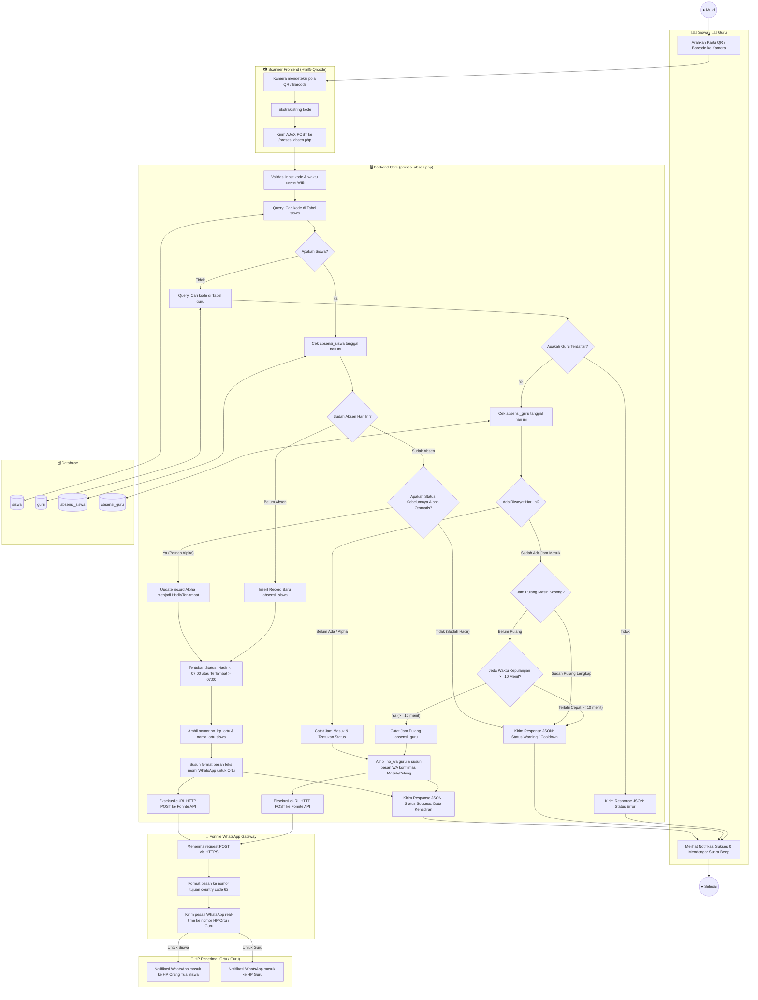
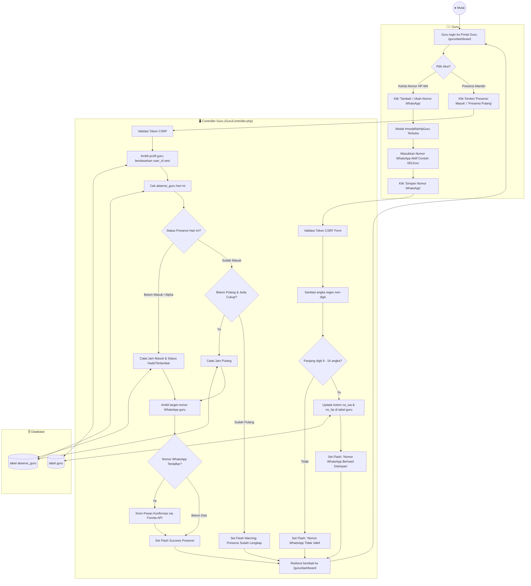
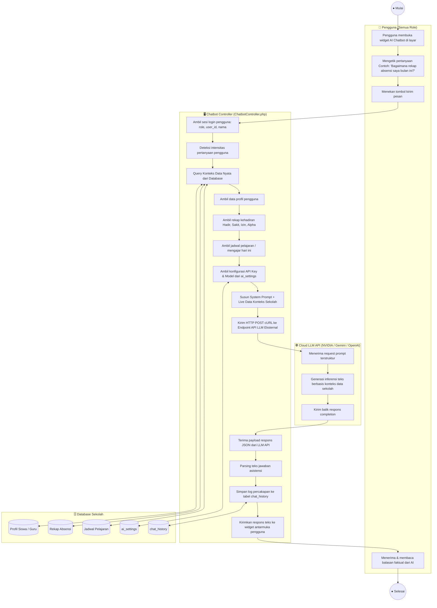
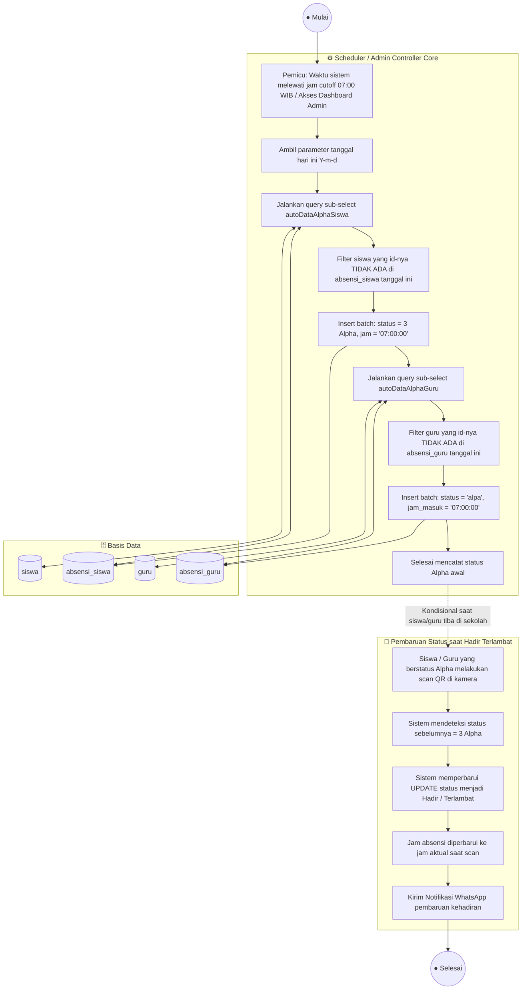
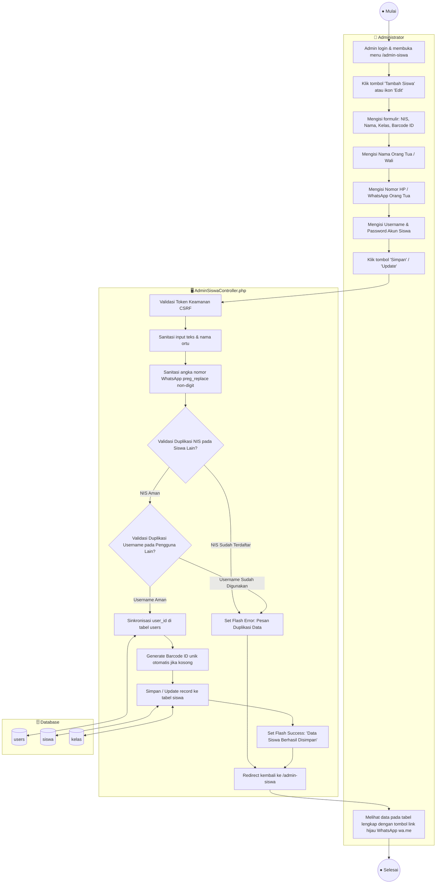

# DOKUMENTASI UML ACTIVITY DIAGRAM
## SISTEM INFORMASI PRESENSI & ABSENSI SISWA & GURU
### SMK NU WARGABINANGUN

Dokumen ini memuat perancangan **UML Activity Diagram (Diagram Aktivitas)** resmi untuk alur kerja operasional pada **Sistem Absensi SMK NU WARGABINANGUN**, mencakup integrasi pemindaian **Kamera Barcode/QR**, pengiriman **Notifikasi WhatsApp Real-time (Fonnte API)**, asisten **AI Chatbot**, dan otomatisasi status kehadiran.

---

## DAFTAR ALUR PROSES (ACTIVITY DIAGRAMS)

1. **Activity Diagram 1**: Autentikasi Pengguna & Pengalihan Hak Akses (Login Flow)
2. **Activity Diagram 2**: Pemindaian Presensi Scanner Universal & Pengiriman Notifikasi WhatsApp (Core Attendance Flow)
3. **Activity Diagram 3**: Presensi Mandiri & Pengaturan Nomor WhatsApp Guru (Guru Dashboard Flow)
4. **Activity Diagram 4**: Konsultasi Interaktif Asisten Cerdas AI Chatbot (Live DB RAG Context Flow)
5. **Activity Diagram 5**: Sinkronisasi & Penanganan Status Alpha Otomatis (Auto-Alpha Flow)
6. **Activity Diagram 6**: Manajemen Master Data Siswa & Kontak WhatsApp Orang Tua (Admin Data Flow)

---

## 1. ACTIVITY DIAGRAM 1: AUTENTIKASI PENGGUNA & PENGALIHAN ROLE

Diagram ini menggambarkan alur saat pengguna (Admin, Guru, Siswa, Wali Kelas, Kepala Sekolah) masuk ke dalam sistem absensi melalui validasi kredensial, proteksi CSRF, enkripsi bcrypt, dan pengalihan ke dashboard masing-masing.

```mermaid
flowchart TD
    %% Node Awal
    StartNode((● Mulai)) --> A1[Pengguna membuka URL /auth]

    subgraph User_Lane["👤 Pengguna"]
        A1
        A2[Memasukkan Username / NIS / NIP & Password]
        A3[Menekan tombol 'Masuk ke Sistem']
    end

    subgraph System_Lane["🖥️ Sistem Backend (AuthController)"]
        B1[Generate & Validasi Token CSRF]
        B2{Token CSRF Valid?}
        B3[Cari Akun di Tabel users]
        B4{Akun Ditemukan & Aktif?}
        B5[Verifikasi Password via password_verify]
        B6{Password Cocok?}
        B7[Regenerasi Sesi ID session_regenerate_id]
        B8[Simpan Data Sesi: user_id, username, role, nama]
        B9[Cek Hak Akses Role Pengguna]
        B10[Redirect ke Dashboard Admin]
        B11[Redirect ke Dashboard Guru]
        B12[Redirect ke Dashboard Siswa]
        B13[Redirect ke Dashboard Wali Kelas]
        B14[Redirect ke Dashboard Kepala Sekolah]
        B_Err1[Set Flash Message: 'CSRF Token Invalid']
        B_Err2[Set Flash Message: 'Akun Tidak Ditemukan / Nonaktif']
        B_Err3[Set Flash Message: 'Password Salah']
        B_Redirect[Redirect kembali ke /auth]
    end

    subgraph DB_Lane["🗄️ Database (MariaDB)"]
        D1[(Tabel users)]
        D2[(Tabel guru / siswa)]
    end

    A1 --> A2 --> A3 --> B1
    B1 --> B2
    B2 -- Tidak --> B_Err1 --> B_Redirect --> A1
    B2 -- Ya --> B3
    B3 <--> D1
    B3 --> B4
    B4 -- Tidak --> B_Err2 --> B_Redirect
    B4 -- Ya --> B5
    B5 --> B6
    B6 -- Tidak --> B_Err3 --> B_Redirect
    B6 -- Ya --> B7 --> B8
    B8 <--> D2
    B8 --> B9
    
    B9 -- role = 'admin' --> B10
    B9 -- role = 'guru' --> B11
    B9 -- role = 'siswa' --> B12
    B9 -- role = 'wali_kelas' --> B13
    B9 -- role = 'kepala_sekolah' --> B14

    B10 --> End1((● Selesai))
    B11 --> End1
    B12 --> End1
    B13 --> End1
    B14 --> End1
```

---

## 2. ACTIVITY DIAGRAM 2: PEMINDAIAN SCANNER UNIVERSAL & NOTIFIKASI WHATSAPP

Diagram inti ini menunjukkan alur kerja dari pemindaian kode QR/Barcode di kamera scanner sekolah, identifikasi entitas (Siswa vs Guru), pencatatan jam dan status presensi ke database, hingga pengiriman **Notifikasi WhatsApp Otomatis** ke Orang Tua atau Guru melalui **Fonnte API Gateway**.

---

## 3. ACTIVITY DIAGRAM 3: PRESENSI MANDIRI & KELOLA NOMOR WHATSAPP GURU

Diagram ini menunjukkan interaksi guru pada portal pribadinya untuk mengelola kontak WhatsApp dan melakukan presensi kehadiran mandiri (Jam Masuk dan Jam Pulang) langsung dari tombol dashboard.

---

## 4. ACTIVITY DIAGRAM 4: KONSULTASI INTERAKTIF ASISTEN CERDAS AI CHATBOT

Diagram ini memperlihatkan mekanisme pemrosesan asisten cerdas AI Chatbot yang menyuntikkan data riil database (*Live DB Context Injection*) ke dalam *prompt* sebelum dikirimkan ke penyedia LLM API (NVIDIA, Gemini, OpenAI, atau DeepSeek).

---

## 5. ACTIVITY DIAGRAM 5: SINKRONISASI STATUS ALPHA OTOMATIS (AUTO-ALPHA)

Diagram ini mengilustrasikan proses otomatisasi sistem dalam mengidentifikasi siswa dan guru yang belum hadir pada hari aktif sekolah dan mencatatnya sebagai status Alpha secara otomatis.

---

## 6. ACTIVITY DIAGRAM 6: MANAJEMEN MASTER DATA SISWA & KONTAK ORTU

Diagram ini menggambarkan alur kerja Administrator dalam menginput dan memperbarui data siswa beserta informasi nomor WhatsApp orang tua untuk integrasi notifikasi absensi.

