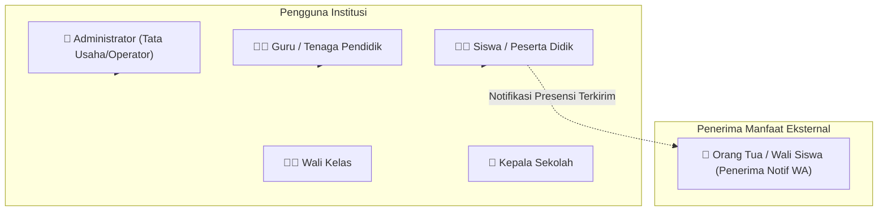
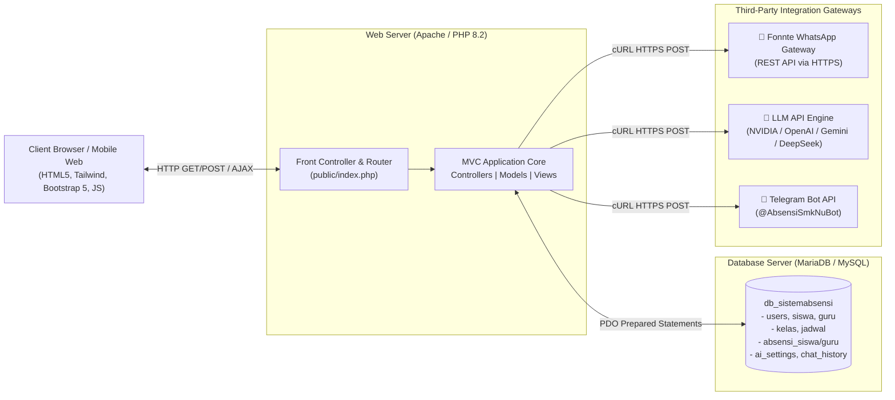
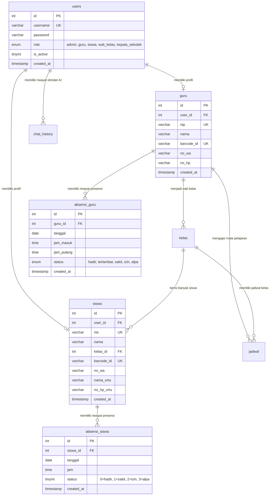
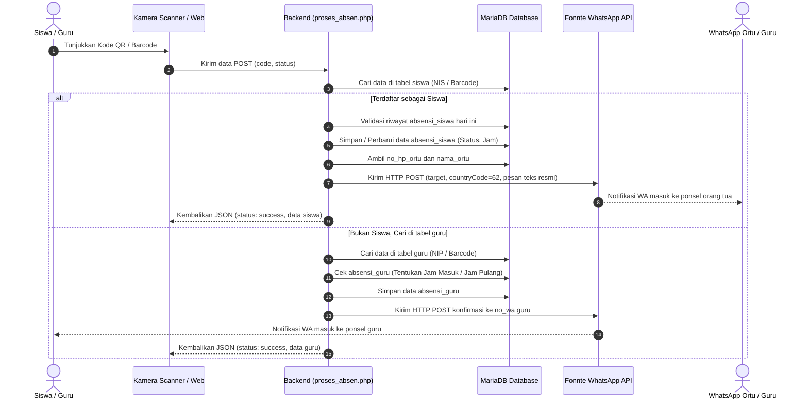
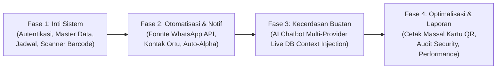

# PRODUCT REQUIREMENT DOCUMENT (PRD)
## SISTEM INFORMASI PRESENSI & ABSENSI SISWA & GURU
### SMK NU WARGABINANGUN

---

## 1. INFORMASI DOKUMEN & METADATA

| Item | Deskripsi |
| :--- | :--- |
| **Nama Produk** | Sistem Informasi Presensi & Absensi Digital Terintegrasi |
| **Instansi / Sekolah** | SMK NU WARGABINANGUN |
| **Versi Dokumen** | 2.1 (Production Ready) |
| **Status Dokumen** | Approved / Implemented |
| **Disusun Oleh** | Tim Pengembang Sistem & Analis Produk TI |
| **Platform Target** | Web Application (Responsive Desktop, Tablet, Mobile) |
| **Basis Arsitektur** | Custom Native PHP MVC + MariaDB / MySQL + REST API Gateway |

---

## 2. LATAR BELAKANG & VISI PRODUK

### 2.1 Latar Belakang (Problem Statement)
Proses pencatatan kehadiran manual (konvensional) di institusi pendidikan seperti SMK NU WARGABINANGUN menghadapi berbagai kendala:
1. **Inefisiensi Waktu & Antrean**: Pencatatan tanda tangan manual memakan waktu pembelajaran efektif di awal jam sekolah.
2. **Keterbatasan Transparansi ke Wali Murid**: Orang tua siswa sering kali tidak mengetahui kepastian apakah anak mereka telah tiba di sekolah atau membolos di perjalanan.
3. **Rekapitulasi Manual Rentan Human Error**: Guru piket dan tim kurikulum memerlukan waktu lama untuk mengumpulkan, merekapitulasi, dan memvalidasi presensi bulanan.
4. **Kesulitan Presensi Guru**: Guru membutuhkan fleksibilitas pencatatan kehadiran (baik melalui scanner barcode gerbang maupun absensi mandiri dari portal saat bertugas).
5. **Ketiadaan Layanan Informasi Cepat**: Siswa dan guru membutuhkan akses cepat terkait jadwal pelajaran dan riwayat kehadiran tanpa harus bertanya berulang kali ke staf tata usaha.

### 2.2 Visi & Solusi Produk
Membangun platform absensi berbasis web cerdas dan terintegrasi yang mampu:
- Memindai kode QR / Barcode secara instan melalui kamera gawai atau scanner fisik.
- Mengirimkan **Notifikasi WhatsApp Otomatis (Real-time)** ke nomor orang tua/wali murid saat siswa absen, serta ke nomor guru saat jam masuk dan kepulangan.
- Menyediakan asisten cerdas berbasis **AI Chatbot (LLM API)** yang terkoneksi langsung dengan basis data jadwal dan riwayat kehadiran.
- Mengotomatisasi pendataan status siswa/guru yang tidak hadir dengan fitur **Auto-Data Alpha** pada jam batas toleransi keterlambatan.

---

## 3. TUJUAN BISNIS & INDIKATOR KEBERHASILAN (KPI)

| Parameter KPI | Kondisi Sebelum Sistem | Target / Capaian Sistem Baru |
| :--- | :--- | :--- |
| **Kecepatan Presensi per Orang** | 15 – 30 detik (tulis manual) | **< 1 detik** (scan QR otomatis) |
| **Waktu Pengiriman Notifikasi ke Ortu** | Tidak ada / Panggilan manual | **< 5 detik** langsung ke WhatsApp Ortu |
| **Akurasi Data Absensi** | 75% – 85% (human error) | **99.9%** (tervalidasi sistem & timestamp) |
| **Waktu Pembuatan Rekap Laporan Bulanan** | 3 – 5 hari kerja | **1 klik instan** (dapat difilter dan dicetak) |
| **Tingkat Transparansi Kehadiran** | Rendah (hanya diketahui guru piket) | **Tinggi** (diketahui sekolah, guru, ortu, siswa) |

---

## 4. STAKEHOLDER & USER PERSONA



### 4.1 Persona Pengguna
1. **Administrator Sistem**:
   - *Tanggung Jawab*: Mengelola seluruh data master (siswa, guru, kelas, jadwal, akun login), konfigurasi API AI & Fonnte WhatsApp, cetak kartu QR, audit absensi.
   - *Kebutuhan Utama*: Antarmuka CRUD yang cepat, validasi data ketat, fitur filter pencarian, dan alat cetak massal (*batch print*).
2. **Guru (Tenaga Pendidik)**:
   - *Tanggung Jawab*: Melakukan presensi masuk & pulang, mengajar sesuai jadwal, memantau kehadiran pribadi.
   - *Kebutuhan Utama*: Fitur presensi mandiri dari dashboard, pengaturan nomor WhatsApp mandiri, dan ringkasan jadwal mengajar mingguan.
3. **Siswa (Peserta Didik)**:
   - *Tanggung Jawab*: Hadir tepat waktu dan melakukan scan kode QR.
   - *Kebutuhan Utama*: Tampilan kode QR pribadi yang mudah diunduh / disimpan di galeri HP, informasi jadwal belajar, dan riwayat presensi.
4. **Wali Kelas**:
   - *Tanggung Jawab*: Membina kedisiplinan siswa di kelas binaan.
   - *Kebutuhan Utama*: Dashboard monitoring rekapitulasi kehadiran harian/bulanan khusus kelas yang diampu.
5. **Kepala Sekolah**:
   - *Tanggung Jawab*: Monitoring eksekutif dan pengambilan kebijakan sekolah.
   - *Kebutuhan Utama*: Ringkasan statistik persentase kehadiran harian dan grafik tren kehadiran.
6. **Orang Tua / Wali Siswa (Passive Actor)**:
   - *Kebutuhan Utama*: Menerima pesan teks WhatsApp resmi saat putra-putrinya melakukan presensi di sekolah tanpa perlu menginstal aplikasi tambahan.

---

## 5. ARSITEKTUR TEKNIS & STACK TEKNOLOGI



### 5.1 Spesifikasi Komponen Teknologi
- **Backend Environment**: PHP 8.2.x (Native MVC Architecture dengan pemisahan Controller, Model, View, dan Core Library).
- **Database Engine**: MariaDB 10.4.x / MySQL 8.0 (InnoDB Engine, UTF8mb4 charset, Foreign Key Constraints).
- **Frontend Framework & Libraries**:
  - CSS: Bootstrap 5.3 + Custom School Theme (`style.css`).
  - Icons: Bootstrap Icons v1.11.
  - Charting: Chart.js untuk analitik grafik kehadiran.
  - Barcode & QR Code: `Html5-Qrcode` (kamera pemindai) & `QRCode.js` (generator QR sisi klien).
- **Integrasi Pihak Ketiga**:
  - **Fonnte WhatsApp API**: Pengiriman pesan teks WhatsApp melalui endpoint resmi `https://api.fonnte.com/send`.
  - **AI Model Integrations**: OpenAI REST API standard format yang mendukung provider NVIDIA NIM, OpenAI, Google Gemini, dan DeepSeek.
  - **Telegram Bot API**: Sebagai redundansi notifikasi broadcast saluran administrasi sekolah.

---

## 6. SPESIFIKASI KEBUTUHAN FUNGSIONAL (FUNCTIONAL REQUIREMENTS)

### 6.1 Modul 1: Autentikasi & Manajemen Pengguna
- **FR-01.1 (Multi-role Login)**: Pengguna dapat masuk menggunakan Username / NIS / NIP dan password. Sistem mengarahkan otomatis ke dashboard sesuai role (`admin`, `guru`, `siswa`, `wali_kelas`, `kepala_sekolah`).
- **FR-01.2 (Session Security)**: Password dienkripsi menggunakan algoritma `password_hash()` bcrypt. Dilengkapi regenerasi session ID saat login sukses untuk mencegah *session fixation*.
- **FR-01.3 (CSRF Protection)**: Setiap permintaan formulir POST dilindungi dengan token CSRF unik yang divalidasi oleh library `Csrf::validate()`.
- **FR-01.4 (Manajemen User & Admin)**: Admin dapat membuat, mengubah, menonaktifkan, atau mereset password akun pengguna dan akun sesama admin.

### 6.2 Modul 2: Manajemen Data Master
- **FR-02.1 (Data Siswa & Kontak Ortu)**:
  - Admin dapat mengelola data siswa (NIS, Nama Lengkap, Kelas, Barcode ID).
  - Admin dapat menginput **Nama Orang Tua / Wali** dan **Nomor HP / WhatsApp Orang Tua**.
  - Kolom nomor WhatsApp dilengkapi sanitasi angka dan tombol klik obrolan langsung (`https://wa.me/62...`).
- **FR-02.2 (Data Guru & No. HP/WA)**:
  - Admin dapat mengelola NIP, Nama Lengkap (otomatis menghapus gelar sebutan bapak/ibu yang berulang), akun login, dan **Nomor HP / WhatsApp Guru**.
  - Dilengkapi tombol obrolan langsung WhatsApp pada tabel data guru.
- **FR-02.3 (Data Kelas & Wali Kelas)**:
  - Manajemen nama kelas tingkat X, XI, XII.
  - Penugasan guru sebagai wali kelas dengan relasi foreign key integritas data.
- **FR-02.4 (Data Jadwal Pelajaran)**:
  - Manajemen jadwal mata pelajaran berdasarkan hari (Senin–Sabtu), kelas, jam mulai, jam selesai, dan guru pengampu.
- **FR-02.5 (Generator & Kartu Barcode/QR)**:
  - Otomatisasi generate kode unik `QR-S-[NIS]-[random]` untuk siswa dan `QR-G-[NIP]-[random]` untuk guru.
  - Fitur cetak kartu presensi individu dan cetak massal per kelas dengan layout kartu pelajar/kartu pegawai resmi.

### 6.3 Modul 3: Presensi Universal & Logika Scanner
- **FR-03.1 (Universal Camera Scanner)**:
  - Kamera pemindai live berbasis webcam/kamera smartphone (`/absensi/siswa` dan `/absensi/guru`).
  - Scanner bersifat universal: satu kamera dapat memindai baik barcode/QR Siswa maupun Guru.
- **FR-03.2 (Aturan Status & Jam Masuk)**:
  - Jam presensi masuk normal: s.d. pukul `07:00:00 WIB` (Status: Hadir).
  - Jam presensi setelah pukul `07:00:00 WIB`: (Status: Terlambat / Hadir Terlambat).
  - Pilihan status khusus: Sakit (1) dan Izin (2).
- **FR-03.3 (Aturan Presensi Pulang Guru)**:
  - Pemindaian kedua di hari yang sama otomatis dicatat sebagai **Jam Pulang**.
  - Proteksi jeda waktu (*cooldown*): Sistem menolak presensi pulang jika dilakukan kurang dari 10 menit setelah jam masuk.
- **FR-03.4 (Auto-Data Alpha Otomatis)**:
  - Sistem memiliki logika otomatis yang mengeksekusi penandaan status **Alpha (3)** bagi seluruh siswa dan guru yang belum tercatat presensinya pada hari berjalan.
  - Jika siswa/guru yang berstatus Alpha kemudian melakukan scan presensi, sistem secara cerdas memperbarui (*update*) status Alpha tersebut menjadi Hadir / Terlambat.

### 6.4 Modul 4: Integrasi Notifikasi WhatsApp (Fonnte API)
- **FR-04.1 (Notifikasi Absensi Siswa ke Orang Tua)**:
  - Sesaat setelah sistem mencatat presensi siswa, sistem mengambil nomor WhatsApp orang tua (`no_hp_ortu`).
  - Mengirim pesan teks resmi dengan kop "SMK NU WARGABINANGUN", menyapa nama orang tua, serta memuat detail NIS, Nama, Kelas, Jam Absen, dan Status Kehadiran.
- **FR-04.2 (Notifikasi Absensi Guru)**:
  - Mengirim pesan konfirmasi kehadiran ke nomor HP/WA guru saat jam masuk berhasil dicatat.
  - Mengirim pesan konfirmasi kepulangan ke nomor HP/WA guru saat jam pulang berhasil dicatat.
- **FR-04.3 (Pola Format Pesan WhatsApp)**:
```text
📢 *NOTIFIKASI PRESENSI SISWA - SMK NU WARGABINANGUN*
━━━━━━━━━━━━━━━━━━━━
Kepada Yth: *[Nama Orang Tua / Wali]*

Menginformasikan bahwa putra/putri Anda:
👤 *Nama Siswa:* [Nama Lengkap Siswa]
🆔 *NIS:* [Nomor Induk Siswa]
🏫 *Kelas:* [Nama Kelas]
⏰ *Waktu Absen:* [DD-MM-YYYY HH:MM] WIB
📌 *Status Kehadiran:* ✅ Hadir / ⏰ Terlambat / 🤒 Sakit / ✉️ Izin
━━━━━━━━━━━━━━━━━━━━
_Notifikasi otomatis dari Sistem Absensi SMK NU WARGABINANGUN._
```

### 6.5 Modul 5: Asisten Cerdas AI Chatbot
- **FR-05.1 (Widget Chat Interaktif)**:
  - Tampil di pojok kanan bawah pada seluruh halaman pengguna yang telah login.
  - Menyimpan riwayat obrolan sesi pengguna di database tabel `chat_history`.
- **FR-05.2 (Injeksi Konteks Database Nyata / Live DB RAG)**:
  - Saat pengguna bertanya mengenai data diri, rekap absensi, atau jadwal pelajaran, controller AI secara otomatis menarik data riil dari database (tanpa halusinasi) dan menyertakannya ke dalam *system prompt*.
- **FR-05.3 (Multi-Provider LLM Config)**:
  - Admin dapat memilih provider: NVIDIA NIM API, OpenAI, Google Gemini, atau DeepSeek.
  - Fitur pengujian API Key dan penarikan daftar model yang tersedia secara dinamis (*live fetch models*).

### 6.6 Modul 6: Portal Pengguna Berbasis Peran
- **FR-06.1 (Portal Siswa)**:
  - Menampilkan kartu profil lengkap dengan preview QR Code yang dapat diperbesar dan diunduh.
  - Menampilkan jadwal belajar hari ini dan jadwal satu minggu.
  - Menampilkan rekapitulasi kehadiran (Total Hadir, Sakit, Izin, Alpha) dan riwayat absensi.
  - Menampilkan data orang tua dan no WA secara *read-only* (perubahan hanya via admin).
- **FR-06.2 (Portal Guru)**:
  - Tombol **Presensi Mandiri** (Jam Masuk dan Jam Pulang) langsung dari dashboard.
  - Modal **Atur / Ubah Nomor WhatsApp Pribadi** mandiri oleh guru.
  - Ringkasan jadwal mengajar dan jumlah tatap muka kelas.
- **FR-06.3 (Portal Wali Kelas & Kepala Sekolah)**:
  - Wali Kelas: Filter absensi berdasarkan tanggal, bulan, dan status khusus kelas binaan.
  - Kepala Sekolah: Statistik rekapitulasi sekolah dan grafik rasio kehadiran harian.

---

## 7. SPESIFIKASI KEBUTUHAN NON-FUNGSIONAL (NON-FUNCTIONAL REQUIREMENTS)

| Kategori | Parameter | Spesifikasi Teknis |
| :--- | :--- | :--- |
| **Performa (Performance)** | *Response Time* Halaman | $\le 500 \text{ ms}$ pada jaringan lokal / internet standar. |
| | *Execution Time* Scan Kamera | $\le 1.2 \text{ detik}$ dari pembacaan frame video hingga respons JSON. |
| | *WhatsApp Delivery Time* | $\le 5 \text{ detik}$ (tergantung antrean gateway Fonnte). |
| **Keamanan (Security)** | Enkripsi Password | Algoritma standar industri `PASSWORD_BCRYPT`. |
| | Proteksi Form & Request | Validasi CSRF Token di seluruh endpoint mutasi (POST/PUT/DELETE). |
| | Pencegahan SQL Injection | Seluruh kueri wajib menggunakan PDO *Prepared Statements* & binding tipe data. |
| | XSS & Output Sanitization | Seluruh variabel output di-escape menggunakan fungsi pembantu `e()` (`htmlspecialchars`). |
| | Batas Otorisasi (IDOR Prevention) | Pengecekan sesi server-side `checkAuth()` pada setiap *construct* controller. |
| **Ketersediaan (Reliability)** | Penanganan Database Error | Penanganan *PDOException* terpusat; fail-safe saat koneksi internet terputus pada webhook WA. |
| | Auto-Redirect | Root folder otomatis mengalihkan permintaan ke folder `/public/`. |
| **Antarmuka & Kompatibilitas** | *Responsive Design* | Kompatibel penuh pada layar desktop monitor, laptop, tablet, dan layar ponsel (360px+). |
| | Kompatibilitas Browser | Google Chrome (v90+), Mozilla Firefox (v90+), Microsoft Edge, Safari Mobile. |

---

## 8. STRUKTUR ENTITAS BASIS DATA (DATA DICTIONARY)



---

## 9. ALUR PROSES UTAMA (BUSINESS WORKFLOWS)

### 9.1 Alur Pemindaian Presensi & Notifikasi WhatsApp Real-Time



---

## 10. MATRIX PERBANDINGAN FITUR ANTAR PERAN (ROLE-BASED MATRIX)

| Fitur / Modul | Administrator | Guru | Siswa | Wali Kelas | Kepala Sekolah |
| :--- | :---: | :---: | :---: | :---: | :---: |
| **Login & Dashboard Ringkasan** | ✅ | ✅ | ✅ | ✅ | ✅ |
| **Kelola Master Data Siswa & Kontak Ortu** | ✅ (CRUD) | ❌ | ❌ (Read-only ortu) | ❌ | ❌ |
| **Kelola Master Data Guru & No HP** | ✅ (CRUD) | ❌ | ❌ | ❌ | ❌ |
| **Atur Nomor WhatsApp Mandiri** | ❌ (Via Master) | ✅ (Di Dashboard) | ❌ | ✅ (Di Dashboard) | ❌ |
| **Kelola Kelas & Jadwal Pelajaran** | ✅ (CRUD) | ❌ | ❌ | ❌ | ❌ |
| **Generate & Cetak Kartu Barcode/QR** | ✅ (Individu & Massal) | ❌ | ❌ | ❌ | ❌ |
| **Akses Kamera Scanner Pemindai** | ✅ | ✅ | ❌ | ✅ | ❌ |
| **Presensi Mandiri Jam Masuk & Pulang** | ❌ | ✅ | ❌ | ✅ | ❌ |
| **Menerima Notifikasi WhatsApp Kehadiran** | ❌ | ✅ (Ponsel Pribadi) | ❌ (Dikirim ke Ortu) | ✅ (Ponsel Pribadi) | ❌ |
| **Monitoring Khusus Kelas Binaan** | ❌ | ❌ | ❌ | ✅ | ❌ |
| **Laporan Eksekutif Kehadiran Sekolah** | ✅ | ❌ | ❌ | ❌ | ✅ |
| **Interaksi AI Chatbot Asisten** | ✅ | ✅ | ✅ | ✅ | ✅ |
| **Konfigurasi API AI Multi-Provider** | ✅ | ❌ | ❌ | ❌ | ❌ |

---

## 11. MANAJEMEN RISIKO & MITIGASI TEKNIS

| Potensi Risiko | Tingkat Dampak | Probabilitas | Rencana Mitigasi Teknis |
| :--- | :---: | :---: | :--- |
| **Koneksi Internet Terputus saat Scan** | Tinggi | Sedang | Data absensi tetap tersimpan di basis data lokal XAMPP. Request cURL ke Fonnte dilengkapi *timeout* 8-10 detik agar proses scan di kamera tidak macet (*hang*). |
| **Nomor WhatsApp Ortu Salah / Tidak Aktif** | Sedang | Sedang | Response pengiriman Fonnte disimpan di log server; nomor yang gagal dapat diperiksa dan diperbarui langsung oleh Admin melalui fitur edit siswa. |
| **Kamera Gagal Membaca Barcode** | Sedang | Rendah | Form scanner dilengkapi opsi input manual NIS / NIP menggunakan keyboard atau scanner laser USB. |
| **Crash Database / Unclean Shutdown** | Tinggi | Rendah | Konfigurasi MariaDB InnoDB dengan crash recovery otomatis, tersedianya file `index.php` auto-redirect, serta prosedur verifikasi berkala dengan `aria_chk`. |
| **Quota API AI Chatbot Habis** | Rendah | Sedang | Dashboard Admin menyediakan pilihan ganti provider AI (NVIDIA NIM / Gemini / OpenAI) dan pengisian API Key cadangan secara mandiri. |

---

## 12. TAHAPAN RILIS & ROADMAP PENGEMBANGAN



1. **Fase 1 (Core Foundation - Selesai)**:
   - Perancangan database relational InnoDB dan kerangka kerja MVC.
   - Pembangunan fitur master data siswa, guru, kelas, jadwal, dan generator kartu QR.
   - Implementasi scanner universal kamera HTML5.
2. **Fase 2 (Automated Messaging & Contacts - Selesai)**:
   - Integrasi Fonnte WhatsApp API untuk notifikasi real-time orang tua dan guru.
   - Penambahan kolom kontak orang tua (role siswa) dan kontak HP (role guru).
   - Fitur otomatisasi status Alpha (*Auto-Alpha Sync*).
3. **Fase 3 (AI Intelligence & Chatbot - Selesai)**:
   - Integrasi LLM API multi-provider dengan sistem prompt berbasis data absensi sekolah riil.
   - Implementasi widget obrolan interaktif dan riwayat pesan sesi.
4. **Fase 4 (Maintenance & Next-Gen Roadmap)**:
   - Pengembangan modul rekapitulasi nilai dan keterlambatan kumulatif.
   - Dukungan Progressive Web App (PWA) untuk instalasi aplikasi di layar ponsel tanpa Play Store.
