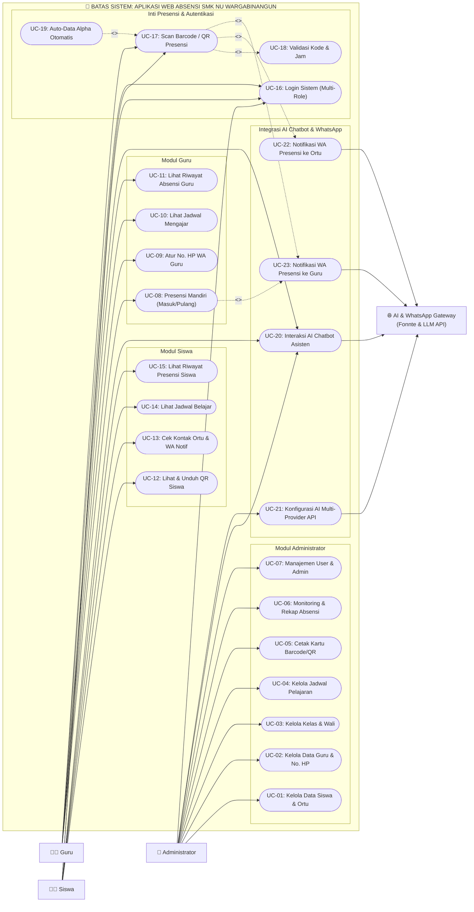

# DOKUMENTASI UML USE CASE DIAGRAM — SISTEM ABSENSI SMK NU WARGABINANGUN

Dokumen ini memuat perancangan arsitektur dan **UML Use Case Diagram** resmi untuk **Sistem Informasi Presensi & Absensi Siswa & Guru SMK NU WARGABINANGUN** berbasis Web & Scanner Barcode/QR dengan integrasi **AI Chatbot (LLM API)** dan **WhatsApp Gateway (Fonnte API)**.

---

## 1. Visual Diagram Use Case (Layout Poster)

Tampilan visual interaktif dapat diakses langsung pada file:
👉 **[Buka Diagram Visual Interaktif (HTML / SVG): use_case_diagram.html](file:///C:/Users/asusn/.gemini/antigravity/brain/fbd3a97a-f47a-4847-ab7e-dcf941ffe401/use_case_diagram.html)**

---

## 2. Struktur Aktor Sistem (Actors)

Sistem membagi peran menjadi dua kelompok utama:

### A. Aktor Utama Pengguna (Primary Human Actors)
1. **👤 «Actor» ADMINISTRATOR**:
   - Memiliki kendali penuh terhadap sistem absensi.
   - Mengelola master data siswa, guru, kelas, jadwal pelajaran, dan akun login.
   - Melakukan konfigurasi API AI Chatbot (NVIDIA, OpenAI, Gemini, DeepSeek).
   - Menghasilkan (*generate*) serta mencetak kartu barcode/QR presensi.
   - Memantau rekapitulasi kehadiran dan cetak laporan sekolah.
2. **👨‍🏫 «Actor» GURU**:
   - Melakukan presensi kehadiran (bisa melalui pemindaian kamera/scanner sekolah atau presensi mandiri jam masuk & jam pulang di dashboard).
   - Mengatur / memperbarui nomor HP WhatsApp pribadi untuk penerimaan notifikasi absensi masuk/pulang.
   - Memeriksa jadwal mengajar harian/mingguan dan riwayat rekap presensi pribadi.
   - Berkonsultasi dengan asisten AI Chatbot.
3. **👨‍🎓 «Actor» SISWA**:
   - Memiliki dan mengunduh kartu kode QR presensi pribadi untuk dipindai di sekolah.
   - Melihat jadwal belajar kelas dan riwayat absensi pribadi.
   - Memeriksa nomor WhatsApp orang tua yang didaftarkan oleh admin sekolah.
   - Berkonsultasi dengan asisten AI Chatbot.

### B. Aktor Sistem Eksternal (Secondary / External API Actors)
4. **🌐 «Secondary Actor» AI CHATBOT & WHATSAPP GATEWAY (FONNTE)**:
   - **📲 Fonnte WhatsApp API**: Gateway pengiriman pesan notifikasi otomatis secara *real-time* saat absensi berhasil dicatat:
     - Mengirim ke **Nomor WhatsApp Orang Tua** saat siswa melakukan absensi.
     - Mengirim ke **Nomor WhatsApp Guru** saat guru melakukan absensi masuk maupun pulang.
   - **🤖 LLM API Engine (NVIDIA / Gemini / OpenAI / DeepSeek)**: Mesin AI pemroses bahasa alami (*Natural Language Processing*) yang dihubungkan dengan basis data absensi sekolah untuk menjawab pertanyaan seputar rekap kehadiran, jadwal pelajaran, profil, dan panduan sistem secara cerdas.

---

## 3. Daftar & Nomor Resmi Use Case (23 Use Cases)

| No. | Kode Use Case | Nama Use Case | Kategori / Modul | Aktor Terkait |
| :---: | :--- | :--- | :--- | :--- |
| 1 | **UC-01** | Kelola Data Siswa & Kontak Ortu | Master Data Admin | Administrator |
| 2 | **UC-02** | Kelola Data Guru & No. HP/WA | Master Data Admin | Administrator |
| 3 | **UC-03** | Kelola Data Kelas & Wali Kelas | Master Data Admin | Administrator |
| 4 | **UC-04** | Kelola Data Jadwal Pelajaran | Master Data Admin | Administrator |
| 5 | **UC-05** | Cetak Kartu Barcode/QR Siswa & Guru | Barcode & Kartu | Administrator |
| 6 | **UC-06** | Monitoring & Rekap Absensi Sekolah | Laporan & Monitoring | Administrator |
| 7 | **UC-07** | Manajemen Akun Pengguna & Admin | Keamanan & Pengguna | Administrator |
| 8 | **UC-08** | Presensi Mandiri (Masuk / Pulang) | Portal Guru | Guru |
| 9 | **UC-09** | Atur / Update No. HP WA Guru | Profil & Kontak Guru | Guru |
| 10 | **UC-10** | Lihat Jadwal Mengajar Guru | Portal Guru | Guru |
| 11 | **UC-11** | Lihat Riwayat & Rekap Absensi Pribadi | Portal Guru | Guru |
| 12 | **UC-12** | Lihat & Unduh QR Code Siswa | Portal Siswa | Siswa |
| 13 | **UC-13** | Cek Kontak Ortu & No. WA Notifikasi | Portal Siswa | Siswa |
| 14 | **UC-14** | Lihat Jadwal Pelajaran Belajar | Portal Siswa | Siswa |
| 15 | **UC-15** | Lihat Riwayat Presensi Kehadiran | Portal Siswa | Siswa |
| 16 | **UC-16** | Login Sistem (Multi-Role Auth) | Autentikasi Sistem | Administrator, Guru, Siswa |
| 17 | **UC-17** | Scan Barcode / QR Presensi Universal | Scanner Kehadiran | Siswa, Guru |
| 18 | **UC-18** | Validasi Kode Barcode & Jam Presensi | Logika Inti Scanner | Sistem (Di-include oleh UC-17) |
| 19 | **UC-19** | Sinkronisasi Status Alpha Otomatis | Otomatisasi Sistem | Sistem (Meng-extend UC-17) |
| 20 | **UC-20** | Interaksi AI Chatbot Asisten Absensi | Kecerdasan Buatan (AI) | Administrator, Guru, Siswa, AI Engine |
| 21 | **UC-21** | Konfigurasi AI Multi-Provider API | Konfigurasi AI | Administrator, AI Engine |
| 22 | **UC-22** | Notifikasi WA Presensi ke Ortu Siswa | Notifikasi WhatsApp | Fonnte Gateway (Di-include oleh UC-17) |
| 23 | **UC-23** | Notifikasi WA Presensi ke Guru | Notifikasi WhatsApp | Fonnte Gateway (Di-include oleh UC-17 & UC-08) |

---

## 4. Spesifikasi Relasi «include» dan «extend»

### A. Relasi «include» (Ketergantungan Wajib)
1. **UC-17 (Scan Barcode/QR) $\xrightarrow{\text{«include»}}$ UC-18 (Validasi Kode & Jam)**:
   - Setiap kali kamera scanner membaca kode QR atau barcode, sistem **wajib** melakukan validasi ke database tabel `siswa` atau `guru`, memeriksa batasan waktu jam operasional, serta mengecek apakah yang bersangkutan sudah pernah absen di hari yang sama.
2. **UC-17 (Scan Barcode/QR) $\xrightarrow{\text{«include (Siswa)»}}$ UC-22 (Notifikasi WA Ortu)**:
   - Saat hasil pemindaian kode teridentifikasi sebagai data **Siswa**, sistem secara otomatis memicu pengiriman pesan WhatsApp ke nomor HP orang tua/wali siswa melalui Fonnte API dengan rincian nama siswa, jam, kelas, dan status kehadiran.
3. **UC-17 (Scan Barcode/QR) $\xrightarrow{\text{«include (Guru)»}}$ UC-23 (Notifikasi WA Guru)**:
   - Saat hasil pemindaian kode teridentifikasi sebagai data **Guru**, sistem otomatis memicu pengiriman pesan WhatsApp ke nomor HP guru bersangkutan sebagai bukti konfirmasi jam masuk atau jam pulang.
4. **UC-08 (Presensi Mandiri Guru) $\xrightarrow{\text{«include»}}$ UC-23 (Notifikasi WA Guru)**:
   - Saat guru menekan tombol "Presensi Masuk" atau "Presensi Pulang" dari dalam dashboard guru, sistem secara otomatis mengeksekusi pengiriman notifikasi WhatsApp ke nomor guru.
5. **UC-20 (Interaksi AI Chatbot) $\xrightarrow{\text{«include»}}$ Query Live Database**:
   - Sebelum mengirim *prompt* ke API LLM eksternal, sistem secara otomatis mengambil konteks data pengguna yang sedang login (identitas, rekapitulasi kehadiran bulan berjalan, jadwal hari ini) agar AI dapat menjawab dengan data faktual sekolah.

### B. Relasi «extend» (Perluasan Kondisional)
1. **UC-19 (Sinkronisasi Status Alpha) $\xrightarrow{\text{«extend»}}$ UC-17 (Scan Barcode/QR)**:
   - Siswa yang sebelumnya sudah ditandai status Alpha otomatis (karena belum hadir hingga batas waktu jam 07:00 WIB), dapat diperbarui statusnya menjadi Hadir / Terlambat ketika ia memindai kode QR pada scanner.

---

## 5. Diagram Mermaid (Representasi Teknis)

